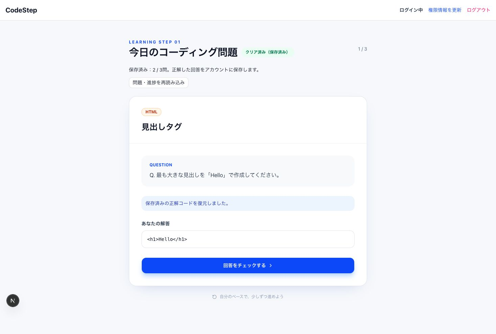

# CodeStep

Web開発の初学者がコード問題へ回答し、その場の解説で理解を深める学習アプリです。講座の最終課題・転職活動用ポートフォリオとして制作しています。過剰な機能より、基本的な認証・CRUD・認可・保存の説明可能性を優先しています。

## 公開URLと現在地

[公開アプリ](https://codestep-two.vercel.app)

**本番questionsは緊急停止により閲覧のみです。通常ブラウザからの作成・編集・削除は停止中です。** 既存データとRLSは維持し、匿名HTTP読み取りも確認しました。[実施記録](./docs/production-emergency-stop.md)

管理者UI・DB出題・本人進捗保存/復元は実装済みで、作業ブランチのPreviewで検証します。本番公開版には未反映です。改修前mainの35c13e3を基準に元の配置・文言・管理者導線を復元し、追加説明と再読み込みボタンを除去しました。現在のDB/Auth/保存/CRUD・認可処理は維持しています。[UI比較・検証記録](./docs/ui-restoration.md)。旧7ポリシーからの切り替えなど、本番移行の未検証項目は残っています。

[公開前の確認・反映順序・失敗時の対応](./docs/release-readiness.md)に、PCで確認する内容をまとめています。

## 機能と状態

| 機能 | ローカル実装 | 検証・公開状態 |
| --- | --- | --- |
| 登録/ログイン/ログアウト | Supabase Auth、メール確認待ちの案内 | staging実Auth9件成功。一般/管理者の実ブラウザログイン・ログアウト確認。登録メールの実送信は未検証 |
| DBからの問題表示・回答判定・解説 | questionsを取得。固定3問は削除 | staging実DB・実ブラウザで成功。架空問題3件を使用 |
| 本人の学習進捗保存/復元 | 正解コード・完了を保存、再読込/再ログイン後に復元 | 実DBと実画面で保存・再ログイン復元に成功。同時保存・他人拒否も実DB確認 |
| 未ログインの学習 | 閲覧/回答のみ、保存しない | 実画面で正誤判定と未保存表示、実APIで書込拒否を確認 |
| 管理者だけの管理UI | 認証確認、フラグ、セッション変更対応 | stagingで一般拒否・管理者表示・JWT更新後の解除を実画面確認 |
| 管理CRUD・二重送信/0件/拒否処理 | Supabase Clientと返却行確認 | staging実APIのCRUD/0件/禁止列/FK拒否が成功。staging実画面は作成・編集まで。削除/FK/0件/通信失敗等の表示はローカル実ブラウザ＋APIモックで確認 |
| 管理者限定RLS | boolean true、本人RLS、最小列権限 | staging初期構築・実API拒否・緊急停止/限定復旧成功。本番旧7件からの切替試験は未完了 |
| 高度なエディタ/辞書/VFS/音響 | 未実装・将来構想 | OneCode構想と区別し、今回追加しない |

正誤判定は前後空白を除く大小文字を区別した文字列一致です。入力コードを実行しません。合格証明や不正防止を備えた試験システムではありません。

## 使用技術と役割

| 技術 | CodeStepでの役割 |
| --- | --- |
| Next.js App Router | /、/login、/questionの画面構成・ビルド |
| React | フォーム、判定、保存状態、セッション別の表示 |
| TypeScript | データ型と応答処理の静的検査。DB応答は実行時にも確認 |
| Tailwind CSS | レスポンシブな画面・共通ボタン |
| Supabase Auth | 認証とJWTセッション。独自パスワード保存をしない |
| PostgreSQL/RLS | 問題/進捗の永続化、FK、利用者ごとのアクセス制御 |
| Vercel | 公開アプリのホスティングとビルド環境 |
| GitHub | ソースと学習成果の履歴・共有 |

ブラウザからJWT付きでData APIへ要求します。管理者はAuth内のapp_metadata.codestep_adminのboolean trueで、新しいpublicテーブルではありません。UIは案内、SQLの権限とRLSは実際の認可を担当します。一般ログインユーザーもauthenticatedなので、ロール名だけで管理者にはしません。

## 保存の設計と制約

正解した本人の回答だけをuser_progressへ保存します。未ログイン/不正解では送信せず、保存応答を確認してから保存済みと表示します。ログアウト/利用者切替で個人の画面状態を破棄します。

本番DBには(user_id, question_id)の一意制約がないためupsertは使いません。最新の本人・問題の行を確認し、存在すれば更新、なければ追加します。プロフィールがなければ初回保存時に本人行を作成し、既存の表示名やAuthメタデータを変更しません。

stagingにはペア一意制約を追加し、同時INSERTが競合した時だけ本人・同じ問題の行を再確認して更新します。実DBで同時保存後も1件であることを確認しました。その他の列・既存FKは本番に合わせ、profiles.created_at、NO ACTION、NULL可を維持。DB時刻トリガー・profiles/Auth FK・CASCADEは追加していません。本番は一意制約未適用のため、現本番の重複防止は保証できません。

## 構成・設計資料

- app/page.tsx：DB出題・回答・保存/復元画面。
- lib/learning.ts：本人進捗とプロフィール確認、lib/auth-actions.ts：認証応答の分岐。
- app/question/page.tsx・lib/questions.ts：管理CRUD。
- components/AuthProvider.tsx：共有セッション、components/Header.tsx：権限に応じた案内。
- [設計資料一覧](./docs/README.md)、[Week9全5シートの照合・変更提案](./docs/design-review.md)。外部スプレッドシートは未編集。
- [ER図原本](./docs/er-diagram.png)、[ワイヤーフレーム原本](./docs/wireframe.png)、[旧学習画面画像](./docs/app-learning.png)。原本を保持。画像は旧版で、現機能の証拠にはしません。
- 最新の[ログイン画面](./docs/screenshots/login-staging.jpg)・[スマートフォン幅](./docs/screenshots/login-mobile-staging.jpg)はstaging接続のローカル画面です。出題・保存成功の証跡ではありません。
- staging接続の最新画像：[保存成功](./docs/screenshots/learning-saved-staging.jpg)、[再ログイン復元](./docs/screenshots/learning-restored-staging.jpg)、[スマホ学習画面](./docs/screenshots/learning-mobile-staging.jpg)、[管理画面](./docs/screenshots/admin-staging.jpg)。管理画像には使い捨ての試験問題を含みます。



CodeStepの対象は問題・回答・本人進捗です。Week9のOneCode名義の高度な構想と混同しません。新しいER/フローの補足はdesign-review.mdに記載しています。

## ローカル検証

Node.js 24系・npm 11系。検証に使用した依存を再現するためnpm/package-lock.jsonへ統一しました。異なる依存解決を含むpnpm-lock.yamlは除去し、依存バージョンの更新はしていません。環境変数を含まない一時コピーで`npm ci --ignore-scripts --no-audit --no-fund`とテスト/型検査/ビルドが成功しました。通常のインストールスクリプト実行とVercel上のビルドは未検証です。

```sh
npm test
npm run lint
npm run typecheck
NEXT_PUBLIC_SUPABASE_URL=http://127.0.0.1:54321 NEXT_PUBLIC_SUPABASE_ANON_KEY=local-test-placeholder NEXT_TELEMETRY_DISABLED=1 npm run build -- --webpack
```

lintはTypeScriptの型/未使用検査です（ESLint未導入）。型エラー無視設定は無効化。既存.env.localは本番接続先なので、開発用の書き込み試験で使いません。

成功：単体/通信モック・接続/SQL生成ガードの計56件、型/未使用検査、クリーンインストール後のWebpackビルド。staging実API/DB41項目（基本20＋追加8＋フラグ欠落1＋停止6＋復旧6）と、前フェーズの実Auth9項目を確認。実画面でも出題・回答・保存・再ログイン復元・管理者の作成/編集が成功しました。別にローカル実ブラウザ＋APIモック9項目で、削除確認/FK・0件・権限・通信エラー/保存結果不明後の再試行を確認しました。

未検証：本番旧7ポリシーから4件への切り替えリハーサルは、適用ツールのInvalid or expired requestStateにより実DB未検証です。既存RLS・CRUD・停止/復旧の成功を活用し、現在の開発工程では省略して静的検査へ切り替えました。移行SQLの実行・複合ロールバック、新しい本番進捗SQL原本の一括実行、staging実画面と実APIを組み合わせた削除/0件/通信遮断等は未完了です。[テスト記録](./docs/test-plan.md)末尾に判断理由と残課題を記載しています。通常のnpm testはネットワークや実DBを使いません。

[テスト詳細](./docs/test-plan.md)。モック成功を実DB成功と説明しません。

## 残課題・次の承認

残りの画面異常系、本番移行に残る未検証リスクの確認、本番の本人確認済み管理者指定、管理者RLS/必要な制約の本番反映、承認後のpush・デプロイ。切替試験の再送を他の作業の必須条件にはしません。危険な旧ポリシーを残したまま権限だけ戻しません。

## 生成AIと学習記録

Codexを調査、実装、SQLレビュー、モックテスト、設計照合に利用しました。本番変更は明示承認された緊急停止のみです。制作者本人が差分・判断・未検証事項を読み、自分の言葉で説明することを提出前の条件としています。

[判断履歴](./docs/decisions.md) / [講座と実装技術の区別](./docs/curriculum.md) / [メンター説明・確認5問](./docs/mentor-notes.md)
