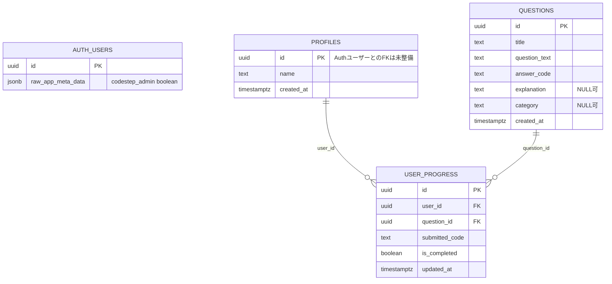
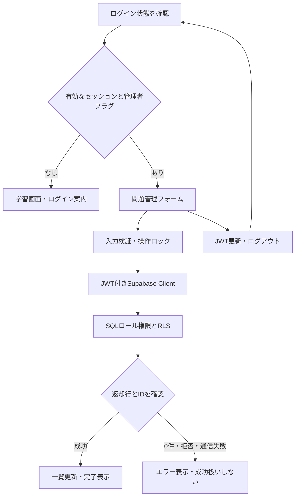
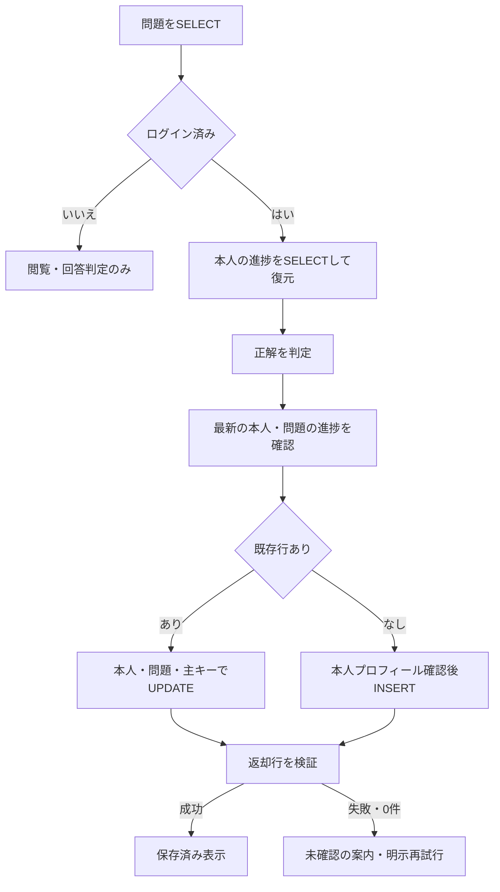

# 設計資料の照合と変更案

2026-10-19：外部シートの本文/メタデータを再読取し、更新日時2026-10-15T01:34:41.267Zが前回と同じことを確認。外部編集なし。現在のER図・認証・削除RPC・管理入口・体験デモを統合した[最終設計](./final-design.md)を新設しました。以下は日付付きの旧仕様・変更案を含む履歴で、現仕様との矛盾は最終設計を優先します。

確認日：2026-10-15。外部ファイルは読み取りのみ。原本のGoogle Sheets・PNGは変更していない。

最新の公開判断は[release-readiness.md](./release-readiness.md)。本書の準備段階に書かれた未実施事項には、その後の検証で完了したものもあるため末尾の最新結果を優先する。Week9全5シートの既存照合は再利用し、今回外部資料を再取得・編集していない。

2026-10-17の明示仕様変更：管理リンクの「管理者だけ表示」は以下で置き換える。学習画面右上は全利用者に表示し、管理者→/admin、その他→/admin/login。一般ユーザーのセッションは自動破棄せず、権限不足の案内と本人によるアカウント切替を提供する。/adminは既存/questionのガード・CRUDを共用。学習者/loginの登録・表示は維持し、管理者入口には登録なし。共通Supabase Authとboolean true判定、DBのRLS/ACLを継続し、独立した認証基盤/サーバーAPI/テーブルは追加しない。基本設計B9、認証の詳細設計、ワイヤーフレームの遷移へのローカル変更案であり、外部シート・ER原本は未編集。新入口はローカル検証のみでPreview未反映。

最新版：[要件定義と設計一部_week9_ のコピー 松明](https://docs.google.com/spreadsheets/d/1l6_wH24I4Cq1jhvHi1VtDjarj5fr8KK6jS0g7HTAtds/edit)。メタデータの更新日時：2026-10-15T01:34:41.267Z。今後は同じURLの最新メタデータを確認してから参照する。

## 全5シートの確認結果

各シートの既存グリッド内A〜Z列を末尾まで読み取った。チェックボックス由来のFALSEだけの行を機能・テスト完了の証拠にしない。個人に関する詳細は転記しない。

| シート（sheetId） | 確認範囲 | 主な内容と判断 |
| --- | --- | --- |
| ペルソナ設計（0） | A1:Z1000 | スキマ時間の初学者、検索・準備負担の軽減。今回の権限制御と矛盾しない。複数の人物案があるため、公開READMEでは対象を一般化する |
| ソリューション検討（1101812407） | A1:Z1001 | 8〜10行に解説付き問題CRUD/反復/ゴール可視化。15〜17行に体験先行案等。CodeStep最小構成と将来案の区分を提案 |
| 機能要件と非機能要件（649127913） | A1:Z1000 | 9行の「CRUDユーザーと管理者両方」と10〜11行の役割区分が不整合。30〜34行に高度な学習機能案 |
| 基本設計（1593576189） | A1:Z1000 | 9行がCodeStep。30〜37行にOneCode名義のVFS/音響等の構想。DB単一テーブルとの記載は現在の3テーブルと不一致 |
| 詳細設計_機能一覧（983827669） | A1:Z999 | 12〜16行が問題CRUD/学習表示。21〜26行は認証・同期・VFS等。権限・0件応答の仕様が不足 |

独立した「想定工数」「テスト仕様書」「ワークフロー図」シートは一覧にない。既存記載から未提供の工数やテスト実績を推定しない。今回のテスト仕様はtest-plan.mdに補う。

## 外部シートへの変更提案（承認待ち）

| 対象セル | 変更案 | 理由・実装との関係 |
| --- | --- | --- |
| 機能要件と非機能要件!B9:B11 | 問題CRUDは管理者のみ。未ログイン/一般ユーザーは閲覧・回答。進捗保存は一般ユーザー本人分だけ（ローカル実装済み、実DB検証待ち） | 権限を今回の確定要件へ合わせる。全利用者のCRUDは採用しない |
| 基本設計!B9 | /questionは認証確認後、管理者だけフォーム表示。/login内で登録切替。管理リンクも管理者のみ | UI制御を追加し、存在しない/signupと区別 |
| 基本設計!C9 | Supabase Client→JWT付きData API→SQL権限とRLS→結果確認。0件・拒否・通信失敗は成功にしない | 独自バックエンドで認可しているとの誤解を防ぐ |
| 基本設計!D9 | publicはprofiles/questions/user_progress。Auth内のapp_metadataを管理者判定に使用。新規管理者テーブルは作らない | 実DBの観測へ合わせる |
| 基本設計!E9 | 「単一テーブル」を訂正。管理者RLSの適用・実DBテストは未完了と記載 | 設計目標と適用状況を区別 |
| 詳細設計_機能一覧!C12:E12 | 管理者確認、5列検証、二重送信防止、返却行確認。成功時は返却行で一覧更新、フォーム初期化、インライン通知 | 実装に合わせる。トースト/常時再取得は必須にしない |
| 詳細設計_機能一覧!C13:E13 | 管理者確認後に一覧取得。ローディング、エラー、空一覧を区別 | 認証前に取得しない |
| 詳細設計_機能一覧!C14:E15 | 主キーで絞り、返却行1件・ID一致で成功。0件は未成功。削除確認、FK拒否、通信失敗を扱う。変更なしは送信しない | 実装とテスト仕様を一致させる |
| 詳細設計_機能一覧!B16:E16 | questionsから出題し、正解した本人の進捗を保存/復元。ローカル実装済み・実DB検証待ちと明記 | 最新指示でDB出題と進捗保存が実装範囲になったため |
| 詳細設計_機能一覧!B21:E21 | パスワード処理・トークン発行はSupabase Authに委ねる。public.users/password_hashを独自実装しない。app_metadataはAuth内部 | セキュリティ上不要な独自認証を避ける |
| 機能要件30〜34行、基本設計30〜37行、詳細設計22〜26行 | CodeStepの今回の完成要件と、OneCode名義を含む将来構想を見出しで区別。進捗のchapter_id/step_name方式は既存question_id方式と次フェーズで整理 | 大きな構想を実装済みとせず、無断削除・機能追加もしない |

ペルソナとソリューションの原文は今回変更不要。問題・解説を同じ画面で扱う目的を維持する。正式な提出スコープから外れる構想の削除は、人間の確認後に行う。

## ER図の補足（既存er-diagram.pngを保持）

app_metadataはAuth内のJSON情報であり、新しいpublicテーブルではない。次は今回観測した関係を示す。auth.usersとprofilesのFKは現在ないため線を引かない。

user_progressは前回読取時0件。今回ローカルの保存処理を実装したが、本番へ保存・デプロイしていない。主キー以外の一意制約はなく、問題の削除は進捗から参照されていると拒否される。今回、FKや削除方式は変えない。

## ワイヤーフレーム・ワークフローの補足

wireframe.pngの/signupは現在/loginの登録モード。学習画面→管理画面のリンクは管理者だけ。未ログインでも学習可能。図の「進捗表示」は今回ローカル実装。未ログイン時は保存しないと表示し、ログイン後も保存応答を確認するまで保存済みにしない。

JWT更新/ログアウト時は古い管理コンポーネントを破棄し、進行中のクライアント要求を中断する。中断がサーバー側の確定済み変更を取り消すとは保証しない。結果不明の書き込みを自動再送しない。

## スクリーンショット

app-learning.pngは変更前の画像で、保存/同期済みを示す表示を含む可能性がある。現在のローカル実装は未保存と表示する。原本は保持し、最新スクリーンショットへの差し替えは画面確認後に行う。旧画像を現在の保存機能の証拠として使わない。

## 今回の追加変更案（外部シート未編集）

- 詳細設計!B16:E16：DBの問題IDとanswer_codeで出題・判定。固定問題は削除。コードは実行せず、大小文字を区別した前後空白除去後の一致判定。0件/読取失敗を表示。
- 詳細設計!B21:E21：Authの確認メール待ちを区別。初回の進捗保存時に本人プロフィールがなければid/nameだけ作成し、既存名は変更しない。
- 詳細設計!B22:E22：chapter_id/step_name/LWW/offline merge案を現スキーマのquestion_id/submitted_code/is_completedに合わせる。正解のみ保存。最新行を更新、未存在なら追加。本人・問題・主キーの条件を指定し、返却行を検証。
- 同時複数タブの一意性、サーバー時刻、profiles/Auth FKは未解決として残す。コードだけでDB制約ができたと説明しない。
- 基本設計!B9:E9：questionsの匿名SELECT、ログイン後の本人progress復元、ログアウト時の個人状態破棄を追記。問題管理の書き込みは本番で緊急停止済み。
- CodeStepの今回の対象は問題・回答・本人進捗。OneCodeのVFS/音響/選択トークン/多段学習/LWW構想は採用しない。

### 学習データフロー

## staging構築案と照合差分（初回提案・現在は末尾参照）

外部5シートは再取得せず、既存のセル別照合を再利用。外部への編集なし。以下はローカル実装/SQL案の補足であり、DB反映済みを意味しない。

- 詳細設計!B21:E21：ログイン初期化中は入力・送信・登録モード切替を無効にする。hydration前の通常フォーム送信を防ぎ、実ブラウザで修正後の認証成功を確認。
- 詳細設計!B22:E22：同時INSERTが一意制約23505で競合した時だけ本人・同じ問題の行を再取得しUPDATE。通信結果不明時は自動再送しない。モックで2ケース追加。
- ER図原本と本番構造は保持。最新staging初期化案ではprogressのユーザー/問題ペアUNIQUEだけを追加し、profiles/Auth FK・連鎖削除・DB時刻トリガーは今回採用しない。Authのapp_metadataはpublicテーブルとして追加しない。既存FK2件はNO ACTIONのまま、参照中の問題/プロフィール削除を拒否する。本番への一意制約追加はデータ整合性の確認と別途承認が必要。
- 管理者RLSは既存のboolean true条件と5列だけのINSERT/UPDATEを再利用。安全側の最終staging案は旧Permissive書込ポリシーを再現しない。本番7件からの置換SQL自体の移行試験は未実施のまま。
- テスト仕様：実Auth/JWT/UI表示の成功と、RLS/CRUD/進捗保存の未実施を分ける。PostgreSQL上のJSON条件SELECTは行アクセスの実証ではない。
- スキーマ変更ツールの拒否により、上記制約/RLSは未適用。承認済みでも実行成功と区別する。schemaは空、Authの架空3件とログイン画面の最新画像のみ準備済み。

## stagingスキーマ整合性の修正版（2026-10-15、当時の適用承認前）

参照元は本番xdnmlfoblqdygsnhkxxpのinformation_schema.columns、pg_constraint/pg_indexes/pg_triggerへのBEGIN READ ONLY SELECT。データ行・Authユーザー・秘密値は取得していない。Week9全5シートの既存照合とER補足、lib/questions.ts・lib/learning.ts・scripts/staging-check.mjsを照合した。

| 項目 | 本番で確認した構造・既存コード | 修正版SQLの判断 |
| --- | --- | --- |
| profiles作成日時 | created_at、timestamptz、NULL可、DEFAULT now()。ER補足もcreated_at。アプリはid/nameのみ挿入 | 誤っていたcreatedAtをcreated_atに訂正。ランナーの読取列も修正 |
| profiles.id | UUID PK、デフォルトなし、AuthへのFKなし | Auth FKとON DELETE CASCADE追加を撤回。本人限定RLSと既存のプロフィール作成処理は維持 |
| progress.user_id FK | profiles(id)を参照、更新/削除ともNO ACTION、非遅延 | CASCADEを撤回。参照先と削除時の挙動を本番に一致 |
| progress.question_id FK | questions(id)を参照、更新/削除ともNO ACTION、非遅延 | 維持。参照中の問題削除は拒否 |
| progress.is_completed | boolean、NULL可、DEFAULT false | 不要なNOT NULL追加を削除。型定義のboolean/nullと一致 |
| progress.updated_at | timestamptz、NULL可、DEFAULT now()。更新はlib/learning.tsが送るクライアント時刻 | 不要なNOT NULL・DB時刻トリガー・関数・専用スキーマを削除。時刻信頼性の改善は別課題 |
| その他の全列 | questions 7列、profiles 3列、progress 6列 | 名前/順序/型/NULL可否/デフォルト/identity/generatedを16列全件比較し一致 |
| PK・既存索引 | PK3件、そのPK索引のみ。CHECK制約なし | PK3件を維持。今回不要なquestion_id追加索引を削除 |
| 進捗の同時初回保存 | 本番にはペアUNIQUEなし。コードは23505時の再確認に対応済み | UNIQUE(user_id, question_id)だけ意図的に追加。重複テストに必要。一意索引は制約に伴い自動作成される |
| アクセス制御 | questionsは本番緊急停止中で旧ポリシーあり。profiles/progressは本人限定の設計 | stagingは管理者限定questions RLS＋本人限定RLS、APIの最小列権限を維持。広い書込許可は再現しない |
| テスト用service_role | ランナーは問題5列INSERTと全3テーブルSELECTを使う。Auth Admin APIは別の仕組み | GRANT ALLを外し、必要なSELECTと問題5列INSERTだけ明示。フロントへのサーバーキー配置なし |

RLS/ACLは今回のセキュリティ検証の意図的差分、テーブル構造上の追加はペアUNIQUEのみ。Auth→profiles FK、連鎖削除、DB時刻の強制、NOT NULL強化、性能用索引は別課題に戻した。したがって現在のコードは列名変更を必要とせず、stagingだけで本番と異なる削除成功を起こさない。

本番にUNIQUEがない以上、stagingで同時保存が成功しても現本番の重複防止を保証しない。初期化は未適用、修正版の承認後も実DB試験が必要。外部設計シートと画像原本は未変更。

### 適用要求本文まで含めた一致確認

原本ファイルは上記修正済みだったが、以前のapply_migration呼出で使ったfunctionsストアstaging_bootstrap_sql/staging_bootstrap_sql_safeには旧createdAt・Auth FK・CASCADEが残っていた。この2件を無効化した。過去のツール呼出本文は当時の記録であり、修正版として再利用しない。拒否理由の詳細は不明のため、不整合がツール拒否の原因だったとは断定しない。

- 唯一のSQL原本：docs/sql/staging-bootstrap.sql。
- レビュー対象：docs/sql/staging-bootstrap.review.json。対象ID/マイグレーション名/原本パス/SHA-256を固定。
- 要求生成：scripts/prepare-staging-migration.mjs。原本を毎回読み直し、照合後にproject_id/name/queryだけの適用引数を生成。ネットワーク・SQL実行機能なし。
- 今回生成した適用要求のqueryと原本は改行を含め完全一致。SHA-256は471571d743080915ecda2b0dae50f6c88754c62262d02eaaa4a82ea159ceb7b1。
- 本番読取スナップショットを再利用して要求本文の16列を比較し差分0。既存FK2件も一致。構造上の追加は重複テスト用UNIQUEだけ、RLS/最小権限の差分理由は前表を継承。
- 4回帰テスト：原本と要求の一致、未レビュー本文差し替え拒否、本番/TodoAppへの対象差し替え拒否、撤回した差分の再混入拒否。いずれもローカルのみ成功。SQL構文・RLSの実DB動作は未検証。

今回の/tmp/codestep-staging-apply-request.jsonは確認用の生成結果。実行時はこれもキャッシュとして流用せず、再生成して承認ハッシュを確認する。修正版の適用は再承認待ち。

## 最新の適用・実測との整合（2026-10-15）

最新ユーザー指示で修正後の構築/試験を続行し、原本から新規生成した要求（SHA-256: 471571d743080915ecda2b0dae50f6c88754c62262d02eaaa4a82ea159ceb7b1）をstagingに適用成功。前段の「未適用」「承認待ち」は当時の状態で、現在は3テーブルが存在する。bootstrapを再実行しない。

DBでもprofilesの列がid/name/created_at、FK2件がNO ACTION、追加Auth FK/CASCADE/不要NOT NULL/時刻トリガーなし、進捗ペアUNIQUEありと照合した。設計上の意図的な構造差分はUNIQUEだけ。profiles/Auth FKやサーバー時刻は将来課題のまま。

実APIで41項目成功。管理者boolean trueのみI/U/D、匿名/一般は閲覧だけ、本人の進捗保存/復元、重複防止、他人拒否、0件/FK、旧JWTの残存、停止/限定復旧が実測と一致した。実画面も出題/回答/本人保存/再ログイン復元/管理者作成・編集を確認し、新しい画像を追加。元のER/ワイヤー画像は保持。

初期4ポリシー構築と本番旧7件→4件は別。後者はprepare-staging-rls-rehearsal.mjsで、単一TX＋排他ロック＋API書込停止の内側だけに旧7件を置く計画を維持。元のquestions-admin-rls.sql本体と不一致ガードを使い、危険な旧許可はコミットしない。実行要求2回の応答期限切れで履歴0、安全な4件の維持を確認したため、切替成功とは扱わない。

画面の削除/FK/0件/通信遮断などの一部異常系はMacロックで中断。APIの成功と画面未確認を分けてtest-plan.mdへ記録。要件/設計を実装済みの表示に合わせたが、これらを検証完了と偽らない。外部5シートは再調査・直接編集していない。

最新の検証方針：旧7件からの移行リハーサルは今回の開発工程では省略し、移行固有のDO実行/複合ロールバック/ロック競合を実DB未検証として本番承認資料に残す。既存の最終RLS/CRUD/停止復旧実測と補強した静的回帰を代替の根拠にする。権限の要件・ER構造・本番SQL原本の設計変更はなく、確認作業の優先順位だけを変更した。警告/確認状態エラーの反復はAGENTS.mdの共通ルールで防ぐ。

## 公開直前の整合性確認

2026-10-15、profiles/progressだけ本番メタデータを追加確認。本人S/I/U各3の6ポリシーは既存設計に合うが、APIロールに不要なテーブル権限がある。既存ポリシー/16列/既存FKを保ったままACLを最小化し、別TXでprogressペアUNIQUEを追加する本番SQL案2本を作成した。これは新規テーブルや設計要件の追加ではなく、stagingで実測済みの保存設計を本番へ反映する準備。原本SQL自体は未適用・実DB未検証。

ローカル実ブラウザ＋APIモック9件で削除/FK/0件/通信失敗等の表示を確認した。既存staging画像は現ローカル実装と照合し、学習・復元・管理UIの証跡として保持。旧ER/ワイヤー原本とapp_metadata注記はそのまま。認証/CRUD/保存のフローに新機能やOneCodeの構想を追加していない。

## 2026-10-16 UI復元の補足

画面の復元基準は改修前mainの35c13e3とし、元のレイアウト/文言/導線を優先する。新しい説明文や常設再読み込みボタンは除去。管理リンクは元のヘッダー右上へ管理者だけ表示し、DB出題/本人保存/認証/CRUDとRLSは維持する。元の常時クリア/復元表示は実データがある場合だけ表示する。ER/スキーマ/外部設計シートの変更はない。詳細・検証結果と比較画像は[UI復元記録](./ui-restoration.md)。2026-10-17に追加の作業ブランチpush/Preview検証が承認された。本番への反映は対象外。
