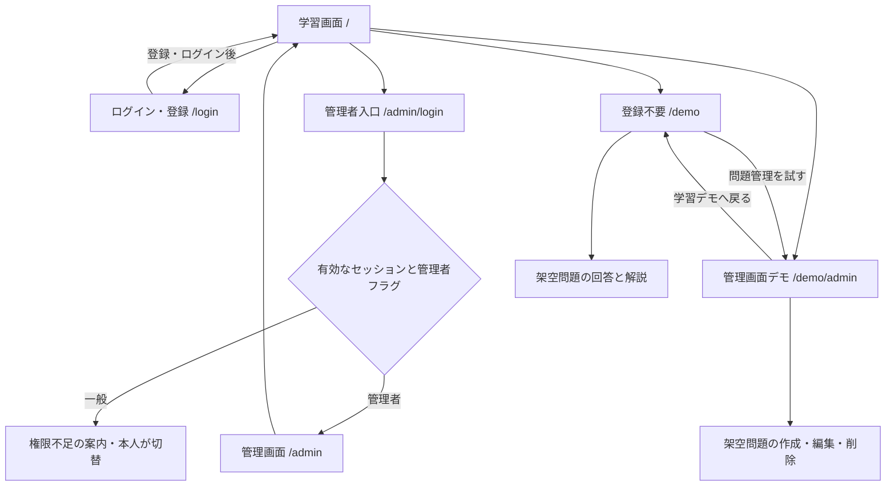
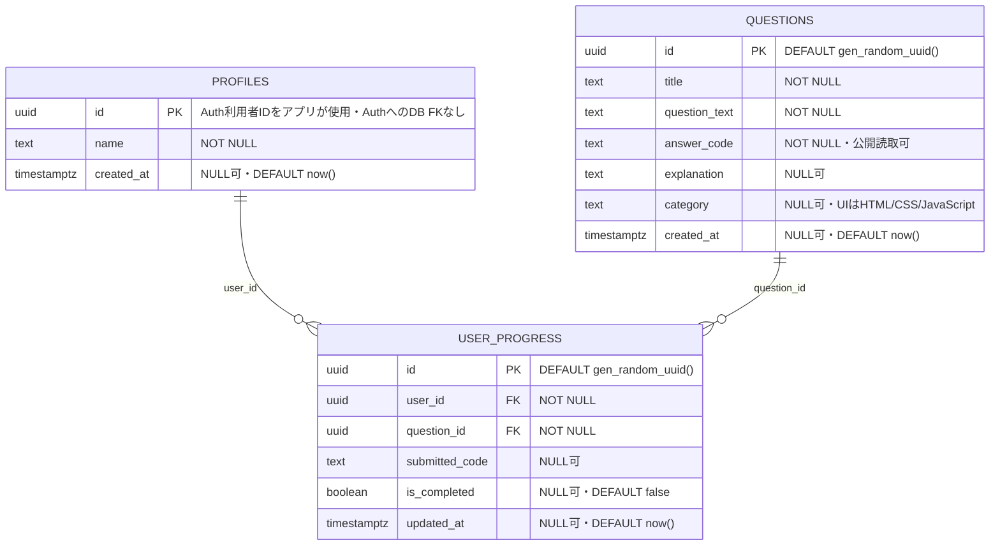

# CodeStep 設計補足

## 対象者・課題・解決策

対象者は、仕事と両立してWeb開発を学ぶ初学者。①20〜30代想定、②日中は仕事、③通勤・休憩の短時間を使う、④スマートフォン操作に慣れている、⑤PCも使う、⑥環境構築や専門用語に不慣れ、⑦入力して理解したい、⑧解説を探す負担を減らしたい、⑨中断から再開したい、⑩完成目標を見失いやすい、という設計上の仮説を置く。個人を特定する情報や調査済みの実測値ではない。

| 課題 | 検討した解決策 | 採否・理由 |
| --- | --- | --- |
| 検索や学習準備に時間を取られる | 1. 問題と解説を同じ画面に表示 | 採用。検索へ移動せず疑問を解消する |
| 同上 | 2. 用語辞書、3. AIへの質問、4. ブックマーク集 | 今回対象外。保守・費用・別画面移動を増やすため |
| 読むだけで入力・復習の頻度が足りない | 5. その場でコード回答と正誤判定、6. 管理者による問題・解説改善 | 採用。短い入力と解説の往復を支援する |
| 同上 | 7. コード実行環境、8. 適応型出題 | 今回対象外。実行隔離や出題アルゴリズムより基本機能の完成を優先 |
| 中断すると進み具合を失う | 9. 本人の正解進捗を保存・復元 | 採用。再ログイン後も再開できる |
| 同上 | 10. 通知・学習ランキング | 今回対象外。継続支援の効果検証や他者データ公開が必要 |

実装範囲は認証・問題管理・本人の学習進捗・RLSを中心とする。入力中にコードの表示結果が変わるリアルタイムプレビューは、当初目指していた学習体験だが未実装であり、改善案として整理している。現行の回答判定は文字列一致のため別解を採点できない。問題の正解コードは公開データであり、厳格な試験や不正防止には使わない。

## 基本構成と画面遷移

デモ学習と管理デモ間は相互に画面移動できる。PR #5のPreviewではデモから通常学習・管理者ログインへの退出リンク、本番学習の問題選択ボタンを追加した。実際の本番反映状況はマージ・デプロイ結果に従う。

ブラウザのReact UI → Supabase JS → Auth（認証・JWT）/Data API → PostgreSQL（列権限・RLS・制約）。独自のパスワード保存・サーバー秘密キー・生成AI APIは使用しない。Next.js App Routerで画面を構成し、Tailwind CSSでPC/スマートフォンに対応する。

| 画面・HTML | 動作・状態・CSS |
| --- | --- |
| 共通header/nav/footer | 学習・ログイン・管理入口・体験デモ・ソースへのリンク。flex-wrapで折返す。デモはAuthProviderを読み込まない |
| 学習main/section/textarea/button | 認証確認→問題読込→回答→正誤→解説。読み込み/空/失敗を区別。正解だけ本人保存、応答を確認後に保存済み表示。ログアウト/利用者切替で個人状態を破棄 |
| ログインform/label/input | 登録とログインのモードを切り替え、送信中は二重送信を防ぐ。Supabase Authで認証し、有効なセッションでは学習画面へ遷移。メール所有確認は現在必須にしていない |
| 管理画面form/一覧/確認 | app_metadata.codestep_adminがboolean trueの有効セッションのみ。入力必須、変更なし送信なし、二重操作防止、0件は失敗。削除は関連進捗警告→取消/明示確定→限定RPC |
| デモmain/nav/form/details | 管理デモへ1クリックで直達。本物と共通のQuestionManager/SiteHeaderを使い、データ処理だけメモリrepositoryへ切替。架空3問の回答/解説/一時クリア、問題の作成/編集/削除確認/初期化。デモ内の学習/管理遷移でメモリを共有し、デモ外離脱・再読込時に初期化。Auth/実DB試験の代用ではない |

## 機能一覧と認可

| 機能 | 呼出・対象 | 成功条件 / 異常時 |
| --- | --- | --- |
| ユーザー登録 | auth.signUp | Supabase Authでメールアドレス・パスワードを登録。現行のConfirm emailはOFFで、メール所有確認は行わない |
| ログイン・維持・ログアウト | signInWithPassword / AuthProvider | セッション共有、期限切れ・切替時は管理UI破棄。通信失敗を成功にしない |
| 問題Read | questions SELECT | ゲストも閲覧。配列/列型確認、0件は空表示 |
| 問題Create/Update | questions INSERT/UPDATE | 管理者のみ。5列限定。返却1行・対象ID一致 |
| 問題Delete | delete_question_with_progress RPC | 管理者検査、対象ID限定、関連進捗の明示承認、単一TX。FKはNO ACTIONのまま |
| 本人進捗Read/Create/Update | user_progress、profiles | auth.uid()=本人、正解のみ保存。初回profile不足時だけ作成。0件/別所有者/通信不明は未成功 |
| 架空デモ | /demo・/demo/adminのReact state | 認証情報・管理者フラグを作らず、DB書込を行わない |

管理者UIの表示条件はDB認可の代わりにならない。最終保証はRLSとSQL権限。user_metadataで認可しない。JWT内の権限には更新遅延がある。

## データベース構成

Supabase Authが認証を担当し、学習アプリのデータは`profiles`・`questions`・`user_progress`の3テーブルで管理する。以下はテーブル間の関係を示す補足図。

- FK2本はON UPDATE/DELETE NO ACTION。CASCADEなし。問題削除RPCが明示承認された関連進捗だけを先に削除する。
- UNIQUE(user_id, question_id)は本番にも適用済み。アプリは最新行の確認→UPDATE/INSERT、一意競合時だけ再確認する。
- Auth利用者はSupabase管理。profiles.idと同じUUIDをアプリで使うが、auth.usersへのFKは存在しない。管理者フラグもpublicの独自テーブルではない。
- created_at/updated_atはNULL可。更新時刻はクライアント指定で、DB自動更新トリガーなし。
- 本番の管理者専用RLSと問題削除RPCは適用済み。問題の作成・編集・削除を管理者本人が本番環境で動作確認済み。管理画面の表示制御に加え、DB側の認可でも一般ユーザーの書き込みを制限する。

管理UIの境界：通常の`/admin`は既存Authガード→共通QuestionManager→SupabaseQuestionRepository→既存CRUD/RPC。`/demo/admin`はDemoProvider→同じQuestionManager→DemoQuestionRepositoryのメモリだけを操作する。通常ルートの認可を維持し、デモから通常repositoryへのフォールバックはない。[比較画像・検証範囲](./admin-demo-parity.md)。
