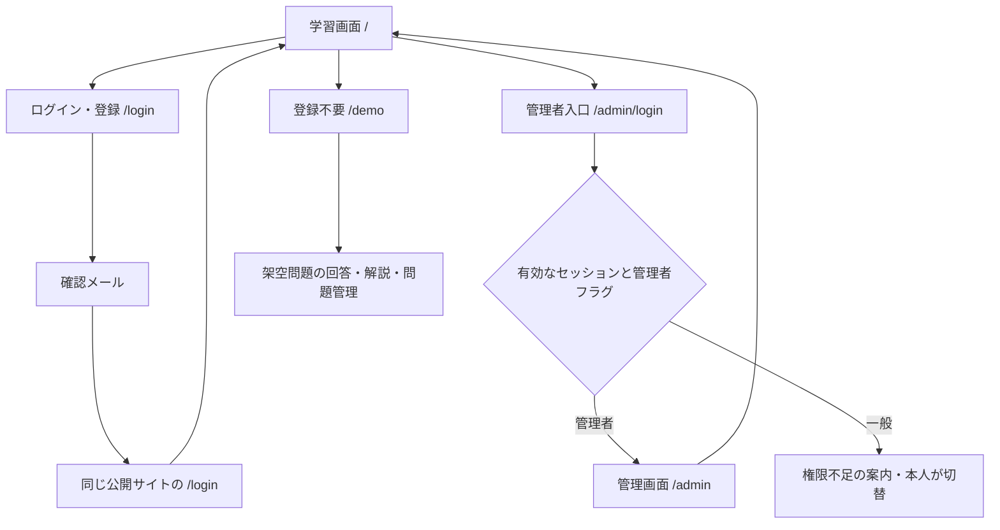
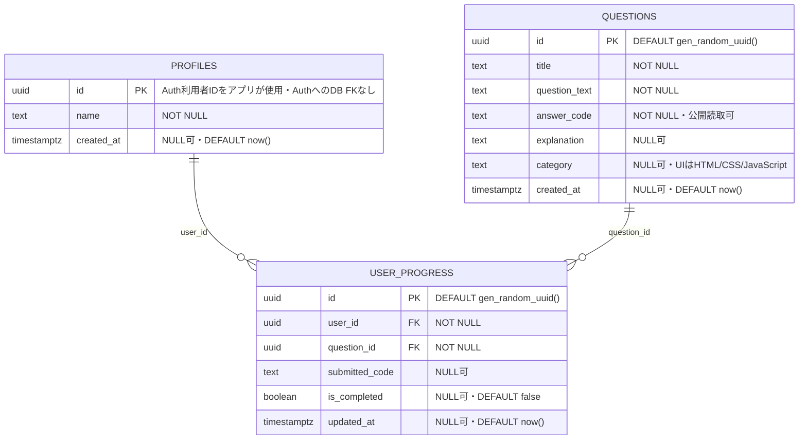

# CodeStep 最終設計（2026-10-19）

最新版の外部設計資料は[Week9設計シート](https://docs.google.com/spreadsheets/d/1l6_wH24I4Cq1jhvHi1VtDjarj5fr8KK6jS0g7HTAtds/edit)。2026-10-19に本文とメタデータを読み取り、更新日時2026-10-15T01:34:41.267Zを確認した。外部シートは未編集。本書は実装との差分を解消するローカル改訂版。旧PNG原本は保持する。

## 対象者・課題・解決策

対象者は、仕事と両立してWeb開発を学ぶ初学者。①20〜30代想定、②日中は仕事、③通勤・休憩の短時間を使う、④スマートフォン操作に慣れている、⑤PCも使う、⑥環境構築や専門用語に不慣れ、⑦入力して理解したい、⑧解説を探す負担を減らしたい、⑨中断から再開したい、⑩完成目標を見失いやすい、という設計上の仮説を置く。個人を特定する情報や調査済みの実測値ではない。

| 課題 | 検討した解決策 | 採否・理由 |
| --- | --- | --- |
| 検索や学習準備に時間を取られる | 1. 問題と解説を同じ画面に表示 | 採用。検索へ移動せず疑問を解消する |
| 同上 | 2. 用語辞書、3. AIへの質問、4. ブックマーク集 | 今回対象外。保守・費用・別画面移動を増やすため |
| 読むだけで入力・復習の頻度が足りない | 5. その場でコード回答と正誤判定、6. 管理者による問題・解説改善 | 採用。短い入力と解説の往復を支援する |
| 同上 | 7. コード実行環境、8. 適応型出題 | 今回対象外。実行隔離や出題アルゴリズムより基本機能の完成を優先 |
| 中断すると進み具合を失う | 9. 本人の正解進捗を保存・復元 | 採用。再ログイン後も再開できる |
| 同上 | 10. 通知・学習ランキング | 今回対象外。継続支援の効果検証や他者データ公開が必要 |

講座課題として、認証・問題CRUD・本人進捗・RLSまでを説明できる範囲に絞る。OneCodeのライブプレビュー・VFS・音響・多段学習はCodeStepの実装済み機能に含めない。文字列一致判定なので別解は採点しない。問題の正解コードは公開データであり、厳格な試験や不正防止には使わない。

## 基本構成と画面遷移

ブラウザのReact UI → Supabase JS → Auth（認証・JWT）/Data API → PostgreSQL（列権限・RLS・制約）。独自のパスワード保存・サーバー秘密キー・生成AI APIは使用しない。Next.js App Routerで画面を構成し、Tailwind CSSでPC/スマートフォンに対応する。

| 画面・HTML | 動作・状態・CSS |
| --- | --- |
| 共通header/nav/footer | 学習・ログイン・管理入口・体験デモ・ソースへのリンク。flex-wrapで折返す。デモはAuthProviderを読み込まない |
| 学習main/section/textarea/button | 認証確認→問題読込→回答→正誤→解説。読み込み/空/失敗を区別。正解だけ本人保存、応答を確認後に保存済み表示。ログアウト/利用者切替で個人状態を破棄 |
| ログインform/label/input | 確認中・処理中は送信を無効化。登録/ログイン/メール確認待ちを区別。登録・再送のemailRedirectToは現在originの/login。確認後のセッションを検出して/へ移動 |
| メール確認エラー/再送button | 期限切れ・使用済みを固定文言で表示。メールアドレス形式を確認し、60秒の再送間隔とSDKの送信制限エラーを扱う。メールアドレスの登録有無を断定しない |
| 管理画面form/一覧/確認 | app_metadata.codestep_adminがboolean trueの有効セッションのみ。入力必須、変更なし送信なし、二重操作防止、0件は失敗。削除は関連進捗警告→取消/明示確定→限定RPC |
| デモmain/nav/form/details | 同じ回答判定・フォーム検証を使う。架空3問の回答/解説/一時クリア、問題の作成/編集/削除確認/初期化。メモリ内のみで離脱・再読込時に初期化。Auth/実DB試験の代用ではない |

## 機能一覧と認可

| 機能 | 呼出・対象 | 成功条件 / 異常時 |
| --- | --- | --- |
| 登録・確認・再送 | auth.signUp / auth.resend | sessionなしは確認待ち。emailRedirectToとSupabase許可URLの両方が必要。送信・配信は別段階 |
| ログイン・維持・ログアウト | signInWithPassword / AuthProvider | セッション共有、期限切れ・切替時は管理UI破棄。通信失敗を成功にしない |
| 問題Read | questions SELECT | ゲストも閲覧。配列/列型確認、0件は空表示 |
| 問題Create/Update | questions INSERT/UPDATE | 管理者のみ。5列限定。返却1行・対象ID一致 |
| 問題Delete | delete_question_with_progress RPC | 管理者検査、対象ID限定、関連進捗の明示承認、単一TX。FKはNO ACTIONのまま |
| 本人進捗Read/Create/Update | user_progress、profiles | auth.uid()=本人、正解のみ保存。初回profile不足時だけ作成。0件/別所有者/通信不明は未成功 |
| 架空デモ | /demoのReact state | 認証情報・管理者フラグを作らず、DB書込を行わない |

管理者UIの表示条件はDB認可の代わりにならない。最終保証はRLSとSQL権限。user_metadataで認可しない。JWT内の権限には更新遅延がある。

## ER図（staging実装、全16列）

2026-10-15の構造照合と適用済みSQL原本を根拠に記載。今回DBへ再照会していない。日付付き観測であり現在の本番構造を保証しない。

- FK2本はON UPDATE/DELETE NO ACTION。CASCADEなし。問題削除RPCが明示承認された関連進捗だけを先に削除する。
- UNIQUE(user_id, question_id)はstagingのみ適用済み。本番未適用。アプリは最新行の確認→UPDATE/INSERT、一意競合時だけ再確認する。
- Auth利用者はSupabase管理。profiles.idと同じUUIDをアプリで使うが、auth.usersへのFKは存在しない。管理者フラグもpublicの独自テーブルではない。
- created_at/updated_atはNULL可。更新時刻はクライアント指定で、DB自動更新トリガーなし。
- 本番はquestions書込停止中。stagingの管理者RLS/RPC成功を本番適用済みと説明しない。

旧画像：[ER原本](./er-diagram.png)、[ワイヤーフレーム原本](./wireframe.png)。本書が現実装との差分を補足する。
